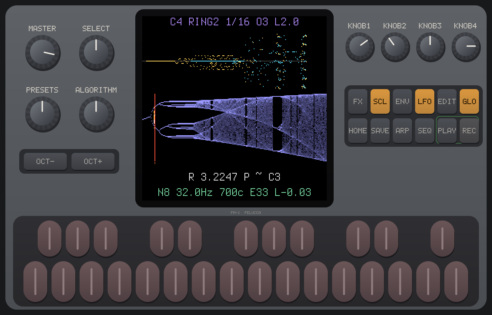

# BUNKI を FM-1 に入れる

`bunki.dock` が FM-1 に入れるファイルです(fm1-dock のモジュール、27 KB)。
M-VAVE のファームウェアを置き換えるのではなく、fm1-dock の上に追加する 1 つのシンセです。



## 入れ方

1. **FM-1 に fm1-dock がまだ入っていなければ**:パソコンの Chrome か Edge で
   <https://joakimeriksson.github.io/fm1-dock/#install> を開き、FM-1 を USB の**データ**ケーブルでつないで
   **Connect over USB** → **Install fm1-dock**。ここで本体のファームウェアが fm1-dock に替わる
   (元に戻す方法は下)。ファームウェアの書き換えは自己責任。
2. 同じページの **console**(<https://joakimeriksson.github.io/fm1-dock/#console>)の **Deploy a module** で
   `bunki.dock` を選ぶ。数秒で入り、そのまま BUNKI が立ち上がる。
   ターミナルからなら下の `deploy.sh`。
3. 次からは **HOME を押して BUNKI を選ぶ**。

### ターミナルから(FM-1 を USB でつないで)

git も Xcode も要らない手順(Mac の zsh にそのまま貼れるよう、コメント行なし)。
python-rtmidi と mido は先に `pip3 install mido python-rtmidi`。

```sh
cd ~/Downloads
curl -L -o fm1-dock.zip https://github.com/joakimeriksson/fm1-dock/archive/60a89df6554f6df3823f03a4c893b6715bfef9b5.zip
unzip -q -o fm1-dock.zip
curl -L -o bunki.dock https://raw.githubusercontent.com/4j8nfjnzdb-a11y/-/refs/heads/claude/adoring-pascal-lwrjgv/bunki/fm1/bunki.dock
cd fm1-dock-60a89df6554f6df3823f03a4c893b6715bfef9b5
python3 tools/dock.py info
```

`info` に FM-1 のビルドや空きが出れば fm1-dock が入っている。そのまま:

```sh
python3 tools/dock.py deploy ~/Downloads/bunki.dock
```

`info` が答えない(純正のファームウェアのまま)なら、先に fm1-dock を入れる(本体のファームウェアが置き換わる。
書き込む前に確認が出る。いまの最新リリースは v0.9.0):

```sh
curl -L -o ~/Downloads/fm1-dock-0.9.0.fwsc https://github.com/joakimeriksson/fm1-dock/releases/download/v0.9.0/fm1-dock-0.9.0.fwsc
python3 tools/fm1_install.py ~/Downloads/fm1-dock-0.9.0.fwsc
python3 tools/dock.py info
python3 tools/dock.py deploy ~/Downloads/bunki.dock
```

外す:`python3 tools/dock.py delete BUNKI`。落ちたときの記録:`python3 tools/dock.py logs`。
FM-1 の MIDI ポートは名前(Felucca / FM1-DOCK / FM-1)で自動で見つかる。見つからないときは `--port 名前` を足す。
git がある環境なら `bunki/fm1/deploy.sh`(`check` / 引数なしで deploy / `delete` / `logs`)が同じことをする。

## 操作

1 つの鍵は **N 本のサイン波の網**。どのサイン波も自分のロジスティック写像を持ち、1 本の **ステップの時計**(RATE)で
いっせいに 1 歩ずつ進む。歩くたびに、写像の値で決まる音程へ弧を描いて滑る(GLIDE)。だから写像の数が音の形で聞こえる:
不動点では鍵の音程の純音、周期 2 は 2 音の往復、4 は 4 音の型、8 は 8 音の型、カオスでは戻ってこない線と、1 本が雲に裂ける
こと、窓では突然 3 音の型。

**ノブには終わりがない。** 回した向きに値がなだらかに動き、値の端まで来ると折り返して、回すかぎり動き続ける。端で折り返す
たびに、もう一つ何かが写像で選び直されるので、往復しても同じ道には戻らない。**ボタンは押すたびに先へ進む。** 次の状態は
それまでに押した回数から写像で選ばれる。長押し(0.6 秒)でそのボタンの状態を終わらせる。

| | |
|---|---|
| 鍵盤 / MIDI | 最大 8 音。1 音だけ、R が低いうちは純音。OCT− / OCT+ は fm1-dock の移調(画面左上に一番低い音の名前) |
| KNOB1 / SELECT | R(粗調 1/16 単位、速く回すと 2〜4 倍 / 微調 1/512)。R 4 で折り返して崩れていき、下で折り返して登る。折り返すたびに網が揺れる |
| KNOB2 | ステップの速さ、1 目盛り半音(0.25〜64 回/秒、端で折り返す)。折り返すたびに GLIDE が選び直される |
| KNOB3 | ε(0〜0.75)。0 でばらばら、0.3 前後で 2 群、0.4 前後で組み替わり続け、0.5 以上で 1 本。折り返すたびに網が揺れる |
| KNOB4 | CENTS(0〜2400)。折り返すたびにオクターブの配り方が選び直される |
| ALGORITHM | サイン波の本数 N(1↔8 を往復)。KNOB2 と一緒に回すと、波のように変わっていく |
| PRESETS | seed(初期値)。どこまでも |
| PLAY | HOLD:離した鍵も鳴り続ける(MIDI CC 64 でも) |
| EDIT | FREEZE:ステップの時計を止める |
| ARP | アルペジオ。押すたびに別の弾き方(順番:下から / 上から / 回る / 両端から内へ、1 ステップのはじく数 ×1〜3、余韻 1.5〜6 はじき分)。網が毎ステップ動くので、音形も順番も止まらない。1 はじきごとに音量は下げない。長押しで止める |
| SEQ | EVOLVE:R が自分で登る。押すたびに向きが変わる(登る ↔ 崩れる)。窓では長く留まる。長押しで止める |
| GLO | 誰が誰を引くか:全部 → 輪(写像が選ぶ間隔で結ぶ。間隔によっては網がいくつかの輪に分かれ、連動したりしなかったりする)→ … → 鍵ごと。長押しで鍵ごとに戻る |
| SEL | MICRO:音程の格子が押すたびに細かくなる。半音 → 1/4 → 1/8 → 1/16 音 → 格子なし、その先は押すたびに網が揺れる。長押しで半音に戻る |
| LFO | OCT:サイン波が離れてよいオクターブ数が押すたびに増える(0〜3)。その先は配り方が選び直される。長押しで 0 |
| ENV | 網を揺らす(MUTATE) |
| FX | TIMBRE:写像を基本周期で回す FM の層(最初の版の音)を重ねる。押すたびに別の比と伸ばし方。長押しで止める |
| REC | ループ。1 回目で記録を始める(鍵盤も、ノブの回し方も、ボタンも)。2 回目でループを閉じて回し始め、それから弾いたもの・回したもの・押したものもその場でループに加わる。3 回目で止めて消す。ノブは回した量で記録されるので、一周するたびにまた回したことになり、ノブに端がない分だけ、ループは繰り返しではなく育っていく |
| SAVE | ノブの位置と、ボタンが残した状態を保存(次に選んだときにその状態で始まる) |
| MIDI CC | 16〜22 がノブ 7 つ(相対、値の差が目盛り)。fm1-dock の KNOBS CC(74 / 71 / 73 / 72)も KNOB1〜4。64 HOLD、120 / 123 全音停止 |

ボタンの LED が、ON になっているもの(HOLD / ARP / EVOLVE / つなぎ方 / FREEZE / MICRO / OCT / TIMBRE)を示す。REC は記録中に点灯、ループ中は薄く光る。

画面:上が **各サイン波の音程の軌跡**(左から右へ 8 秒で一周、中央の線が鍵の音程、色はボイス)。中が分岐図(横軸は伸縮済み:
上の目盛りが倍化点、赤い縦線が今鳴っている R、点線が手の R、白い点がサイン波の写像の今の値)。いちばん上の行は一番低い鍵の
音名と、ON になっているもの(`ARP` `EVO+` / `EVO-` `ALL` `RING3` `FRZ` `1/4` `O2` `FM` `REC` `L2.0`(ループの長さ、秒))。下の 2 行:

- `R 3.5441  P 8 2.00s  C 2`:R、型の長さ(ステップ数と秒数、`~` は周期なし、`..` は計測中)、群の数(写像の値が 0.01 以内のもの)
- `N4 4.0Hz 700c E38 L-0.12`:N、RATE、CENTS、ばらつき(写像の値の 8 区分エントロピー、0〜99)、Lyapunov 指数

## 元に戻す

- **BUNKI だけ外す**:console のモジュール一覧から削除、または `tools/dock.py delete BUNKI`。他は何も変わらない。
- **BUNKI が落ちたら**:fm1-dock は SINE に戻る。2 回落ちたモジュールは、次に選ぶまで起動時に飛ばされる。
  `tools/dock.py logs` に記録が残る。
- **M-VAVE 純正のファームウェアに戻す**:<https://fm1.designburgapps.com>(FM-1 Firmware Hub)を Chrome / Edge で開き、
  純正を入れる。fm1-dock は Hub の更新を受け付ける。
- **起動しなくなったら**:**OCT− を押しながら電源を入れる**と USB レスキューで立ち上がり、そこから入れ直せる。
  それも駄目なら [FM-1-transporter](https://github.com/kurogedelic/FM-1-transporter)(チップの ROM の更新機能を使う)。

## 確かめたこと(fm1-emu の中、fm1-dock 0.9.0 のリリースパッケージの上で)

- 配置 → 起動 → MIDI とパネルで操作。落ちず、ブロックの遅れ 0 件。パネルを一通り使う演奏(R、KNOB2 と ALGORITHM を一緒に、
  ARP を 2 回、REC で記録 → ループ、ループ中に KNOB3・SEL・LFO・GLO、ARP の長押し)で、負荷は最悪 13.5 %(1 ブロック
  5.8 ms のうち)、クリップなし。最も重い組み合わせ(8 音 × 8 本・全部結合・64 回/秒・TIMBRE 層・C8 までの高音)は前の版で 51 %。
- 「ノブ R を回しても音が変わらない」の切り分け(前の版、`bunki_dbg/` のログを出す版):ノブ → u → R → 写像 → 鳴っている
  ボイスまで、どの段にも断線はなかった。原因の候補は、OPTIONS > KNOBS CC が ON(今は CC でも受ける)と、最初の版の音が
  R 3.0 まで純音で、周期 2 の成分(C4 で 131 Hz)が FM-1 のスピーカーではほとんど鳴らないこと。
- モジュールの経路(ノブの数え上げとキュー)がエンジンと同じビットを出すこと:`sim/` の偽ホストで、パネルを一通り使う演奏を
  台本に変換し、ハッシュが一致(`make fm1sim`)。

**まだ確かめていないこと**:実機の FM-1、fm1-dock 1.0、SMK-37。エミュレータは 1 命令 = 1 サイクルで数えるので、実機では
フラッシュから実行するコードのキャッシュミスの分、負荷が上がりうる(最悪の組み合わせは要注意)。

## ビルドし直す

```sh
bunki/fm1/build.sh        # fm1-dock(固定したリビジョン)を取得し、JieLi のツールチェーンで bunki.dock を作る
```

`sim/sim.c` はデスクトップで fm1-dock のふりをする偽ホスト(`make -C bunki fm1sim`)。
`bunki_dbg/` はログを出す版(BUNKIDBG):SAVE でノブの位置・u・R・写像の直近 20 個を `tools/dock.py logs` に出す
(保存はしない)。音が変わらないときの切り分け用。

ライセンス:このディレクトリ(`fm1/`)は fm1-dock の `hb_module.h` を使うので GPL-3.0-only。エンジン(`core/`)は別。
